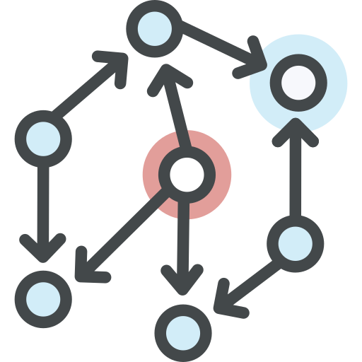
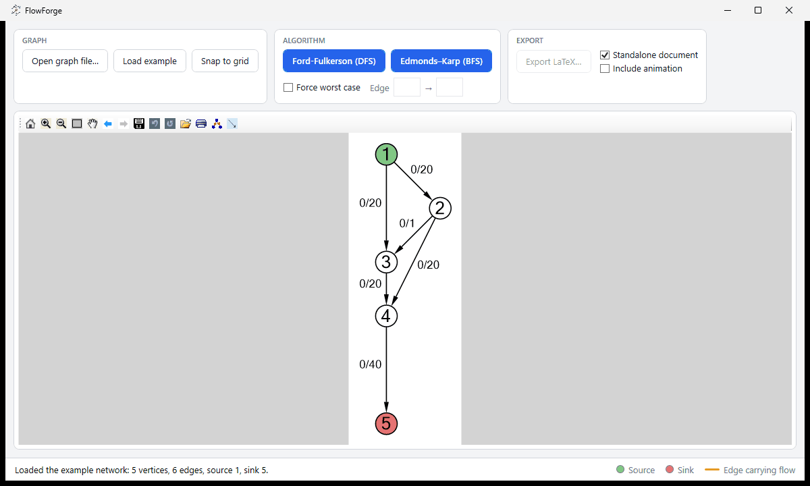
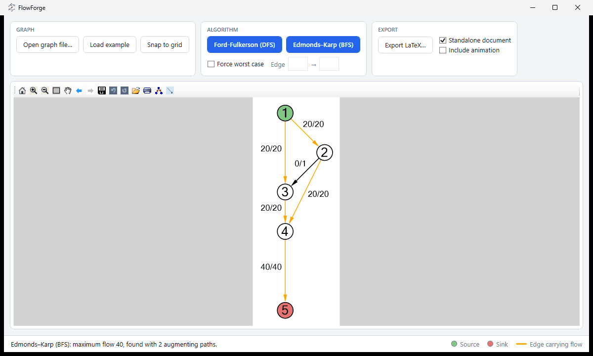
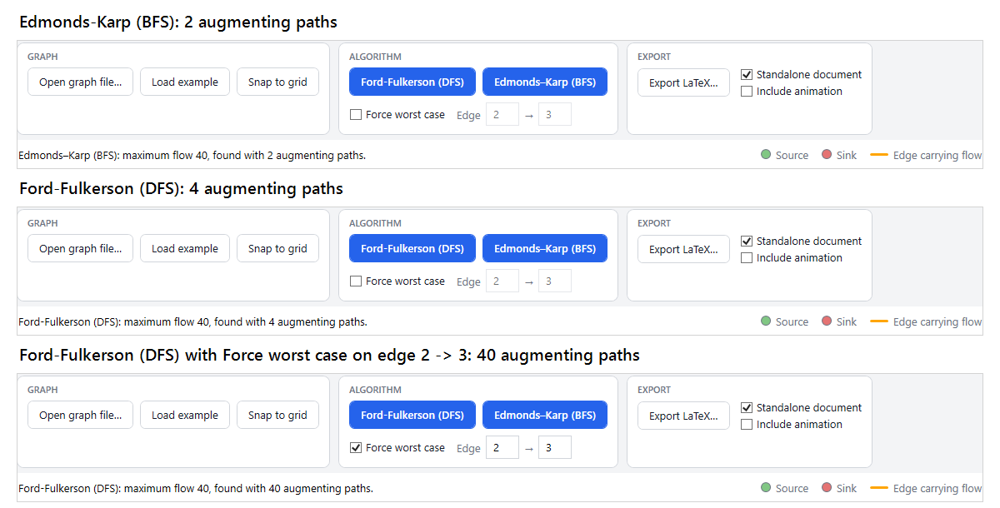

<div align="center">



# FlowForge

**Visualize maximum flow with Ford-Fulkerson and Edmonds-Karp.**

[](https://github.com/roemertimon/flowforge/actions/workflows/build.yml)

[](LICENSE)

</div>

**FlowForge** is a Windows desktop application that visualizes the Ford-Fulkerson and Edmonds-Karp maximum-flow algorithms. Load a flow network, run an algorithm, and watch augmenting paths saturate the edges. It can also provoke the worst case of Ford-Fulkerson on purpose and export the result as TikZ/LaTeX, including a step-by-step Beamer animation.

> The application interface is in English.

## Screenshots

<table>
  <tr>
    <td align="center" width="50%">
      
      <br><sub><b>Example network</b><br>The built-in network, loaded and ready to run.</sub>
    </td>
    <td align="center" width="50%">
      
      <br><sub><b>Result of a run</b><br>Edges carrying flow are orange and labelled <code>flow/capacity</code>.</sub>
    </td>
  </tr>
</table>

### Same flow, very different effort

Every algorithm ends with the same maximum flow of 40, so the final graph looks identical for all runs. What changes is how many augmenting paths are needed, and the status bar shows exactly that:



<sub>Three runs on the example network, each showing the algorithm controls and the status bar. Only the number of augmenting paths differs: 2 (Edmonds-Karp), 4 (Ford-Fulkerson) and 40 (Ford-Fulkerson with <b>Force worst case</b> on edge 2 → 3). To see the individual steps, export the run with <b>Include animation</b>.</sub>

## Background

A *flow network* is a directed graph in which every edge has a capacity. The **maximum-flow problem** asks how much flow can be pushed from a source vertex to a sink vertex without exceeding any edge capacity.

The **Ford-Fulkerson method** repeatedly looks for an *augmenting path*, a path from the source to the sink in the *residual network* that still has spare capacity. It pushes as much flow along that path as the tightest edge allows and updates the residual network, which includes backwards edges that let later paths undo earlier decisions. When no augmenting path is left, the flow is maximal.

How the augmenting path is found matters:

- **Ford-Fulkerson** in FlowForge finds paths with **depth-first search**. Its running time depends on the capacities, because an unlucky choice of paths can push only a single unit of flow per step.
- **Edmonds-Karp** is Ford-Fulkerson with **breadth-first search**. It always augments along a shortest path, which bounds the number of augmentations by a function of the graph size, independent of the capacities.

FlowForge makes this difference visible: the *Force worst case* option routes every augmenting path of the depth-first search through a chosen edge. On the built-in example the maximum flow of 40 is then reached in 40 augmentations instead of 4.

## Features

- Load flow networks from simple text files, or start from a built-in example network.
- Run **Ford-Fulkerson** (depth-first search) or **Edmonds-Karp** (breadth-first search) and see the resulting flow on the graph.
- Force the worst case of Ford-Fulkerson by routing every augmenting path through a chosen edge.
- Review the result at a glance: source and sink are coloured, edges that carry flow are highlighted, and every edge is labelled `flow/capacity`.
- See the maximum flow and the number of augmenting paths in the status bar.
- Drag vertices to rearrange the layout, or snap all of them to a 50-unit grid.
- Pan and zoom the graph with the built-in graph viewer controls.
- Export the graph as TikZ code, either as a complete standalone Beamer document or as a bare `tikzpicture`.
- Optionally export every algorithm step as a Beamer overlay, ready to present as an animation.

## Getting started

### Requirements

- Windows
- [.NET 8 SDK](https://dotnet.microsoft.com/download/dotnet/8.0) with the Windows desktop targeting pack
- Optional: a LaTeX distribution with TikZ and Beamer to compile the exported documents

### Build and run

Clone the repository, then run the application from its root directory:

```powershell
git clone https://github.com/roemertimon/flowforge.git
cd flowforge
dotnet run --project FlowForge.csproj
```

To build without starting the application:

```powershell
dotnet build FlowForge.sln
```

The .NET SDK restores the NuGet dependencies during the first build. Run the tests with `dotnet test FlowForge.sln`.

To just run FlowForge, download `FlowForge.exe` from the [Releases](../../releases) page. It is a self-contained single file and needs no .NET installation. Every push to `master` is built and tested by GitHub Actions, which also publishes a new release.

## Using FlowForge

### Loading a graph

Click **Load example** to open the built-in network, or **Open graph file…** to load your own. The source is always vertex `1` and the sink is the last vertex, vertex `n`. The example uses source `1` and sink `5`.

A graph file is a plain text file. The first line contains the number of vertices `n` (at least 2). Every following line describes one directed edge as `from,to,capacity`. A colon works as a separator as well (`from:to:capacity`). Vertices are numbered from `1` to `n`, capacities must not be negative, and blank lines are ignored. Edges between the same pair of vertices in the same direction are merged by adding their capacities. Errors such as an unknown vertex or a malformed line are reported with the offending line number.

The example network as a file:

```text
5
1,2,20
1,3,20
2,3,1
2,4,20
3,4,20
4,5,40
```

### Running an algorithm

Choose **Ford-Fulkerson (DFS)** or **Edmonds–Karp (BFS)**. The graph is redrawn with the final flow: edges that carry flow are orange, and each edge label shows `flow/capacity`. The status bar reports the maximum flow and the number of augmenting paths that were needed. Each run starts from the original capacities, so you can run both algorithms one after the other and compare them.

### Provoking the worst case

Tick **Force worst case** and enter the start and end vertex of a *special edge*, for example `2` and `3` in the example network. When you run **Ford-Fulkerson (DFS)**, every augmenting path is routed through that edge, or through its residual counterpart once the edge is saturated. With a small capacity on the special edge, each step then pushes only a little flow. FlowForge warns you if the edge you entered does not exist. The option has no effect on Edmonds-Karp.

### Arranging the layout

Drag vertices with the mouse to place them where you want them. **Snap to grid** aligns all vertices to a 50-unit grid. The export uses the positions you see on screen.

### Exporting to LaTeX

After a run, click **Export LaTeX…** to save a `.tex` file. Two options control its contents:

- **Standalone document**: write a complete Beamer document (with TikZ) that compiles on its own. Untick it to get only the `tikzpicture` for pasting into an existing document.
- **Include animation**: add one Beamer overlay per algorithm step, so the algorithm unfolds step by step when presented. Without it, the export shows only the final flow. For a document that is not standalone, the animation needs the Beamer class in the host document.

## Project structure

```text
flowforge/
├── .github/workflows/  GitHub Actions build, test and release workflow
├── Algorithms/         Ford-Fulkerson, search strategies (DFS, BFS) and the worst-case search
├── Export/             TikZ/LaTeX code generation
├── Model/              Flow graph, edges, vertices, file parser and the example network
├── Resources/          Application icon and logo
├── Tests/              xUnit tests for the algorithms, parser and TikZ export
├── Visualization/      Conversion of the flow graph to an MSAGL graph for display
├── App.xaml            WPF application entry point and shared styles
├── MainWindow.xaml     Main window layout
├── FlowForge.csproj    Target framework and NuGet dependencies
└── FlowForge.sln       Visual Studio/Rider solution
```

## Built with

- C# and WPF on .NET 8 for Windows
- [MSAGL (Microsoft Automatic Graph Layout)](https://www.nuget.org/packages/Microsoft.Msagl) for graph layout and the interactive viewer
- [QuikGraph](https://www.nuget.org/packages/QuikGraph) for the graph data structure
- [xUnit](https://xunit.net/) for the tests

## License

FlowForge is released under the [MIT License](LICENSE). You may use, copy, modify, merge, publish, distribute, sublicense and sell it, including in your own projects. The one condition is that the copyright notice and the permission notice from [LICENSE](LICENSE) are included in all copies or substantial portions of the software. The software is provided as is, without warranty.
